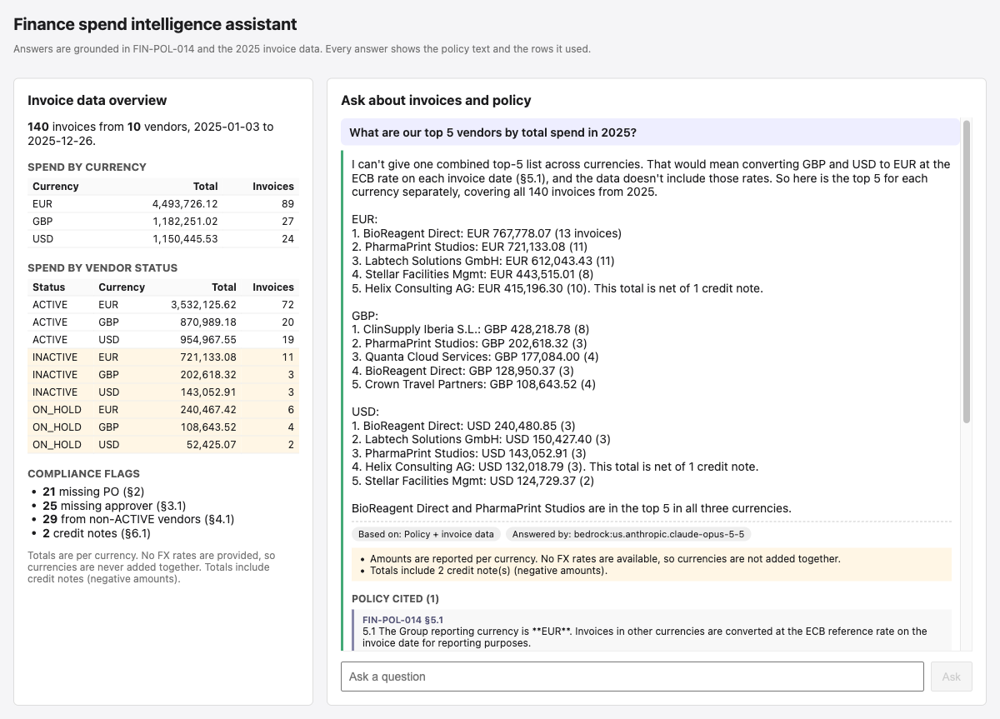
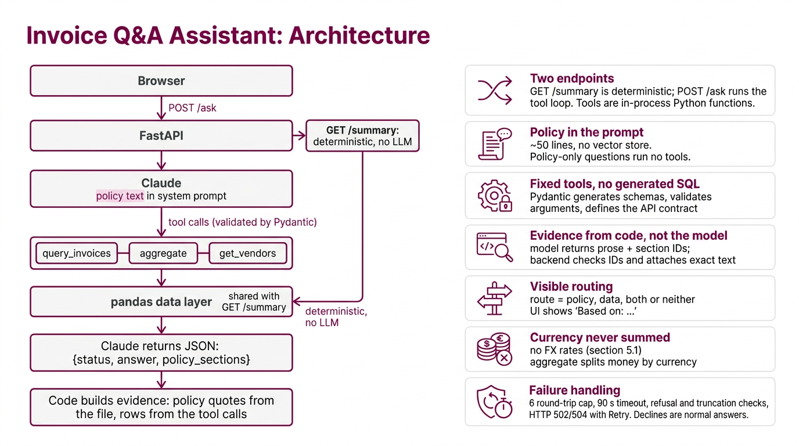

# Finance spend intelligence assistant

A small web app where a finance analyst asks questions about 2025 vendor invoices and the procurement policy (FIN-POL-014), and every answer shows what it is based on: the exact policy text, the invoice rows, and the query that produced them.

FastAPI backend, React (Vite + TypeScript) frontend, Claude Opus 5.5 on AWS Bedrock.



## Contents

- [Setup](#setup)
  - [LLM path](#llm-path)
- [How it works](#how-it-works)
  - [`POST /ask` response](#post-ask-response)
- [Write-up](#write-up)
  - [What I built and what I left out](#what-i-built-and-what-i-left-out)
  - [How I'd evaluate it](#how-id-evaluate-it)
  - [What production would need](#what-production-would-need)
- [Time taken and next steps](#time-taken-and-next-steps)
- [AI harness](#ai-harness)

## Setup

Prerequisites: Python 3.12 with [uv](https://docs.astral.sh/uv/), Node 20+, and Bedrock access to Claude.

```bash
cp .env.example .env          # fill in Bedrock credentials, see comments in the file

# backend on :8000
cd backend
uv sync
uv run uvicorn app.main:app --port 8000

# frontend on :5173 (second terminal)
cd frontend
npm install
npm run dev
```

Open http://localhost:5173. The summary panel loads from `GET /summary` before any question is asked. API docs are at http://localhost:8000/docs.

Tests and eval:

```bash
cd backend
uv run pytest             # data ground truths, citation checker, API contract (no LLM needed)
uv run pytest ../eval -v  # 10-question eval, one test per question (makes real Bedrock calls)
```

### LLM path

**Claude Opus 5.5 on AWS Bedrock** (`us.anthropic.claude-opus-5-5`), through the Anthropic Python SDK's `AnthropicBedrock` client. `.env.example` documents both auth options: a Bedrock API key (`AWS_BEARER_TOKEN_BEDROCK`), which is what I used through a corporate Bedrock gateway (`ANTHROPIC_BEDROCK_BASE_URL`), or standard AWS credentials via boto3.

## How it works



```
Browser --POST /ask--> FastAPI --> Claude (policy text in system prompt)
                                     | tool calls (validated by Pydantic)
                                     v
                     query_invoices / aggregate / get_vendors
                                     | pandas data layer (shared with GET /summary)
                                     v
               Claude returns JSON: {status, answer, policy_sections}
                                     v
       code builds evidence: policy quotes from the file, rows from the tool calls
```

- **Two endpoints.** `GET /summary` is deterministic, no LLM. `POST /ask` runs the tool loop. The three tools are in-process Python functions, not HTTP endpoints.
- **Policy goes in the prompt.** About 50 lines, so no vector store. Policy-only questions ("who approves EUR 60,000?") run no tools.
- **Fixed tools, no generated code or SQL.** The model picks a tool and fills in arguments. Pydantic models generate the tool schemas, validate the arguments (validation errors go back to the model so it can fix the call), and define the API contract.
- **Evidence comes from code, not the model.** The model only returns prose and section IDs. The backend checks each ID against the policy file, drops unknown ones with a warning, and attaches the exact text. Rows and groups come straight from the tool results.
- **Routing is visible.** `route` in the response is derived from what was actually used (`policy`, `data`, both or neither), and the UI shows it as "Based on: ..." above the evidence.
- **Currency is never summed.** There are no FX rates, and §5.1 requires the ECB rate on the invoice date. `aggregate` always splits money metrics by currency in code, so "top 5 vendors" returns a top 5 per currency.
- **Failure handling.** Iteration cap (6 model round trips), 90 s timeout, refusal and truncation checks. All return `{error, message}` with HTTP 502/504, and the UI shows an error with Retry. Bad tool arguments are retried by the model. Declines (`status: "declined"`) are a normal answer, not an error.

### `POST /ask` response

```json
{
  "status": "answered | declined",
  "answer": "prose from the model",
  "route": ["policy", "data"],
  "policy_evidence": [{"section": "4.1", "text": "exact text from procurement_policy.md"}],
  "data_evidence": [{"tool": "query_invoices", "args": {}, "total_matched": 4, "truncated": false, "rows": [], "groups": null}],
  "warnings": ["Amounts are reported per currency..."],
  "llm": "bedrock:us.anthropic.claude-opus-5-5"
}
```

## Write-up

### What I built and what I left out

I put most of the time into grounding and evidence, because a finance tool that is wrong with confidence is worse than none. The model can't compute or invent numbers: totals come from `aggregate`, every group carries the invoice numbers behind it (the lineage §8.2 asks for), and policy quotes are pulled from the file by section ID. For the optional extra I picked the eval set, since the deterministic tools make ground truth cheap and it backs the evaluation section below.

Left out on purpose: auth, Docker, deployment, chat history, streaming responses and visual polish (the brief says so), plus a vector store (not needed at 50 lines). I also left out FX conversion. A static rate table would be an invented assumption in a compliance context, so the app reports per currency and says why. Segregation of duties (§7) is declined because the data has no requester field, and payment status is declined because there is no payment column.

Two model notes. Opus 5.5 rejects `temperature`, so there is no "temperature 0". Repeatability comes from the fixed tools and the JSON output schema. Effort is set to `low`, which kept the eval at 10/10 with answers in 3.6 to 11.4 seconds.

### How I'd evaluate it

- **Ground-truth questions.** `eval/test_eval.py` has 10 questions, one pytest each. Expected values are computed with plain pandas from the CSVs, independently of the app's tools. It checks exact figures in the answer, that the evidence rows match the expected invoice set, required policy citations, that policy-only questions run no query, and that unanswerable questions are declined. Current result: 10/10.
- **Hallucination checks I'd add next.** Extract every number and invoice ID from the answer and confirm each appears in that response's tool results (cheap, deterministic, runs on every request). Track the rate of dropped citations. Measure over-citation too: the model sometimes cites more sections than it needs (§5.1 and §9.1 on a missing-PO count).
- **Decline rate,** split into correct and wrong declines, from a labelled set of answerable and unanswerable questions.
- **Human spot checks.** A finance analyst reviews a weekly sample of real questions with their evidence panels, and the disagreements become new eval cases. I would run the eval in CI on every prompt or tool change.

### What production would need

- **Real data and access control.** Replace the CSVs with read-only queries against the finance warehouse. Enforce row-level security per user (entity, cost center) in the tool layer, not the prompt, so the model can only see rows the user may see. SSO for the 200 users.
- **Audit trail (§8.2).** Persist every question, user, model ID, prompt version, tool call with arguments, returned invoice IDs and the final answer. Today this is only in the logs. Evidence is already structured, so this is a write per request.
- **FX.** Load ECB reference rates by date so EUR-converted totals and threshold checks on GBP and USD invoices become possible, labelled as converted.
- **Cost and latency.** Prompt-cache the system prompt and tool definitions (identical on every call). Route simple lookups to a smaller model and measure quality with the eval before switching. Add per-user rate limits and a spend dashboard.
- **Operations.** Streaming answers, retries with backoff, a real database for conversations, and versioned prompts with the eval as a release gate.

## Time taken and next steps

Planning took about 40 minutes across two sessions (timestamps in `ai_harness/planning_conversation.md`). The build session, from scaffold to eval, README and repo setup, took about 45 minutes ([`ai_harness/build_session.md`](ai_harness/build_session.md)). Planning ran on Claude Sonnet 5.5 and the build on Claude Opus 5.5.

Next steps, in order: number and ID verification against tool results on every answer; a dated FX table so currencies can be combined with a visible label; a tighter citation rule in the prompt to cut over-citing; persisting the audit record per request; streaming.

## AI harness

I built this with Claude Code. Everything the brief asks for is in the repo:

- [`ai_harness/planning_conversation.md`](ai_harness/planning_conversation.md): the planning conversation, where the design decisions were made
- [`ai_harness/implementation_plan.md`](ai_harness/implementation_plan.md): the handoff plan the build followed
- [`ai_harness/build_session.md`](ai_harness/build_session.md): the build session log (Claude Opus 5.5; planning used Claude Sonnet 5.5)
- [`CLAUDE.md`](CLAUDE.md): project instructions for the coding agent
- [`backend/prompts/system.md`](backend/prompts/system.md): the runtime system prompt (the policy is injected at load)
- Tool descriptions in [`backend/app/tools.py`](backend/app/tools.py), which are part of the prompt
